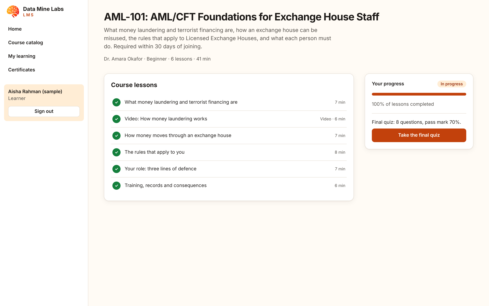

# Data Mine Labs LMS

AML/CFT training for staff of UAE Licensed Exchange Houses, based on the CBUAE Rulebook. Learners enrol in courses,
work through lessons, pass a final quiz and receive a PDF certificate that anyone can verify. Administrators manage
users and publish courses.

This is a rebuild of the original no-build prototype to the **LMS Development Guideline** (architecture, coding
standards and design principles). See [docs/ARCHITECTURE.md](docs/ARCHITECTURE.md) for how the code is organised and
[docs/GUIDELINE-COMPLIANCE.md](docs/GUIDELINE-COMPLIANCE.md) for each requirement and where it is met.

## Stack

| Area | Technology |
| --- | --- |
| Frontend | React 19, TypeScript 5.7, Vite 6, Tailwind CSS 3.4, Radix UI, React Router 8, TanStack React Query 5, Axios |
| Backend | Node.js 22, NestJS 11 (Express), class-validator DTOs, Passport JWT, bcryptjs, Helmet, Throttler |
| Data | PostgreSQL 16, Prisma 5 behind repositories and a Unit of Work |
| Documents | PDFKit (certificates) |
| Quality | Vitest, Testing Library, Playwright end-to-end, ESLint, Prettier, Husky, file-size policy |
| Delivery | Docker, Docker Compose, Bitbucket Pipelines, OCI Registry |

## Run it locally

Requirements: Node.js 22 and PostgreSQL 14 or newer.

```bash
npm install
cp server/.env.example server/.env          # then set DATABASE_URL and a long random JWT_SECRET
npm run db:migrate:dev -w server            # create the tables
SEED_PASSWORD='choose-a-password-1' npm run db:seed -w server   # sample accounts and courses
npm run dev:server                          # API on http://localhost:3000/api/v1
npm run dev:client                          # web app on http://localhost:5173
```

Sample accounts (all use the `SEED_PASSWORD` you chose): `admin@example.com` (administrator),
`aisha.learner@example.com` and `omar.learner@example.com` (learners), and one instructor account per sample course
author (for example `amara.okafor@example.com`). **Remove the sample data before going live.**

Or run the whole stack in containers: create a `.env` next to `docker-compose.yml` with `POSTGRES_PASSWORD` and
`JWT_SECRET`, then `docker compose up --build` and open http://localhost:8080.

## Checks

```bash
npm run verify             # file-size policy, lint, type check, unit and component tests, production build
npm run test:integration   # API tests against PostgreSQL (DATABASE_URL_TEST, default: the local lms_test database)
E2E_PASSWORD=... npm run test:e2e   # browser test of the learner journey against a running, seeded stack
```

The pre-commit hook (Husky) runs ESLint and Prettier on staged files and the file-size check. Bitbucket Pipelines runs
every gate, plus `npm audit`, on each pull request and builds the images on `main`.

## Stage 1 scope

Done: sign-in and roles, user administration, course catalog, course and lesson pages, progress tracking, final quiz
(single choice, multiple choice, true/false, short answer) with random draws and idempotent submissions, PDF
certificates with expiry and public verification, course publishing, audit events for every write.

Next (stage 2): course and quiz editor, matching questions and lesson quizzes, reports and Excel exports (ExcelJS),
email notifications (Nodemailer) and scheduled reminders, OCI Object Storage for uploads, and the compliance,
company and billing features of the original prototype.


